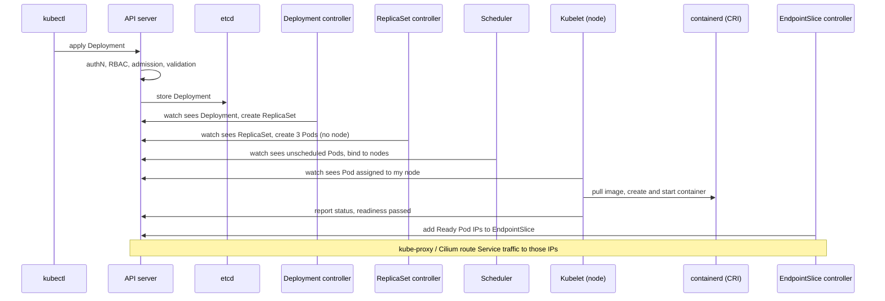

# Day 1 Notes: Kubernetes internals

Date: 2026-10-20
Lab: Killercoda, 2-node cluster (`controlplane` + `node01`), containerd, Cilium CNI

---

## 1. The big picture

A cluster has a **control plane** (the brain: decides) and **worker nodes** (the muscle: run containers).
Say "control plane", not "master" (old term). On EKS, AWS runs the control plane for you and you never see those nodes.

| Component | Runs on | Job |
|---|---|---|
| **kube-apiserver** | control plane | The front door. Authenticates, authorises (RBAC), runs admission controllers, validates, then stores objects. The **only** component that talks to etcd. Everything else talks to it (hub and spoke). |
| **etcd** | control plane | Key-value store holding all cluster state. Lose it with no backup and you lose every object (Deployments, Services, Secrets). |
| **kube-scheduler** | control plane | Picks a node for each pod that has none. Filters nodes, then scores the rest. |
| **kube-controller-manager** | control plane | One process running many controllers: Deployment, ReplicaSet, Node, EndpointSlice, and more. |
| **kubelet** | every node | Node agent. Watches the API server for pods assigned to its node, asks the runtime to run them, mounts volumes and secrets, runs probes, reports status. |
| **container runtime (containerd)** | every node | Pulls images and runs containers. The kubelet talks to it through the **CRI**. (Docker is not the runtime on modern clusters.) |
| **kube-proxy** (or Cilium replacing it) | every node | Programs the node's routing rules so Service IPs reach pod IPs. |
| **CNI plugin (Cilium here)** | every node | Gives pods IPs and handles pod-to-pod networking. |
| **CoreDNS** | `kube-system` | Cluster DNS: a Service name like `web` resolves to its ClusterIP. |

Mental model: **kubelet, container runtime, kube-proxy are node components, not controllers.** Controllers live in the controller manager on the control plane.

---

## 2. The core idea: control loops (reconciliation)

- You declare **desired state** ("3 replicas of nginx"). It is saved in etcd.
- Controllers continuously **watch** the API server, compare desired vs actual, and act to close the gap.
- Components never call each other directly. Each one **watches the API server** for objects it cares about and writes its result back.
- This is why deleting a pod makes a new one appear: the ReplicaSet controller sees 2 of 3 and creates one more.

The word to use in interviews: **reconciliation**.

---

## 3. The flow: `kubectl apply` to traffic served

1. **kubectl to API server.** The request is authenticated, authorised (RBAC), passed through admission controllers (mutating, then validating) and validated against the schema.
2. **API server to etcd.** The Deployment object is stored.
3. **Deployment controller** (watching) sees the new Deployment and creates a **ReplicaSet** (a copy of the pod template plus the replica count).
4. **ReplicaSet controller** sees 0 of 3 pods exist and creates **3 Pod objects**. They have no node yet, so they are `Pending`.
5. **Scheduler** sees pods with no node. It **filters** nodes (resources, taints/tolerations, affinity, nodeSelector), **scores** the survivors, and writes the chosen node back to the API server.
6. **Kubelet** on that node (watching) sees a pod assigned to it. It asks **containerd via CRI** to pull the image and start the container, mounts volumes and secrets (including the service account token), and the CNI assigns the pod IP.
7. **Probes.** Kubelet runs startup/readiness/liveness probes. When readiness passes the pod becomes **Ready** and status is reported to the API server.
8. **EndpointSlice controller.** If a Service selects the pod (by label), the pod's IP is added to the Service's **EndpointSlice** once it is Ready.
9. **Routing.** kube-proxy (or Cilium) on the nodes updates its rules, so traffic to the Service ClusterIP is load-balanced across the ready pod IPs. External traffic comes in through an Ingress or LoadBalancer.

### Diagram



Plain-text fallback:

```
kubectl -> API server -> etcd
                |
                +-> Deployment ctrl -> ReplicaSet -> ReplicaSet ctrl -> Pods (no node)
                |
                +-> Scheduler -> picks node (filter, score)
                |
                +-> Kubelet (node) -> containerd -> container running
                |
                +-> readiness OK -> EndpointSlice updated -> traffic routed
```

---

## 4. How the objects connect

```
Deployment  ->  ReplicaSet  ->  Pods
                                  ^
Service  ->  EndpointSlice  ------+   (found by label selector, Ready pods only)
```

- **Deployment** owns the pod template and update strategy. It creates one **ReplicaSet per version**.
- **ReplicaSet** keeps N pods running. Pods show `Controlled By: ReplicaSet/<name>` (the owner; delete the owner and its pods go too).
- **Rolling update:** new ReplicaSet scales up while the old one scales down, paced by `maxSurge` and `maxUnavailable` (25% by default) and by readiness probes. Both ReplicaSets persist, so `rollout undo` just scales the old one back up.
- **A Deployment does not create a Service.** Someone must create one (`kubectl expose` or YAML).

---

## 5. Labels and selectors

- A **label** is a key-value tag (`app=web`). Pod names and IPs are temporary, so objects find each other by label, not by name.
- **ReplicaSet** counts pods matching its selector. **Service** selects pods to send traffic to. **Deployment** selects the ReplicaSets and pods it owns.
- Automatic labels: `app=<name>` from `kubectl create deployment`; `pod-template-hash` from the Deployment controller (separates ReplicaSets of different versions); `run=<name>` from `kubectl run`; node labels such as `kubernetes.io/hostname`.
- In YAML you write labels yourself. For a Deployment, `selector.matchLabels` must match `template.metadata.labels`.
- **Common failure:** Service has no endpoints because the selector doesn't match pod labels (or the pods aren't Ready).
- **Annotations** are non-identifying metadata (build info, tool config). They are never used for selection.
- Test: `kubectl label pod <name> app-` removes the label, the ReplicaSet no longer counts the pod and creates a replacement.

---

## 6. Scheduling: taints, tolerations, preemption

- **Taint** (on a node): "keep pods away unless they tolerate me." **Toleration** (on a pod): "I accept that taint." A toleration permits, it does not attract.
- Effects: `NoSchedule` (block new pods), `PreferNoSchedule` (avoid if possible), `NoExecute` (block new pods **and evict** running ones without a toleration).
- Normal kubeadm clusters taint the control-plane node (`node-role.kubernetes.io/control-plane:NoSchedule`). **My Killercoda cluster had it removed**, which is why one pod landed on `controlplane`.
- Every pod gets default tolerations for `node.kubernetes.io/not-ready` and `unreachable` with `NoExecute` for 300s. That's how pods leave a dead node after 5 minutes.
- Taints **repel**; `nodeSelector` / affinity **attract**. For "only these workloads on these nodes", combine both.
- **Preemption:** a high-priority pod can evict lower-priority pods to free resources (via `PriorityClass`). It cannot fix taints or affinity, hence the message `Preemption is not helpful for scheduling`.

---

## 7. The `kube-system` namespace

Where Kubernetes runs its own components. In my lab: `etcd`, `kube-apiserver`, `kube-scheduler`, `kube-controller-manager` (static pods), `coredns`, `cilium`, `cilium-envoy`, `cilium-operator`.

- **Static pods:** control plane components are started by the kubelet from manifest files (`/etc/kubernetes/manifests`) on the control-plane node, not through the API server. This is how the cluster bootstraps itself.
- No `kube-proxy` pod appeared here. Cilium can replace kube-proxy (verify with `kubectl get ds -A`).
- On EKS the same namespace holds `kube-proxy`, `aws-node` (VPC CNI) and `coredns`.
- Don't experiment in `kube-system` on a real cluster.
- The `kubernetes` Service (ClusterIP `10.96.0.1:443`) in `default` is created automatically. It gives pods a stable address for the API server. It has no selector; the API server maintains its endpoint.

---

## 8. What I saw in my own lab

Events from `kubectl get events -w` after creating the Deployment, mapped to the flow:

| Event (Reason) | Source | Flow step |
|---|---|---|
| `ScalingReplicaSet` (scaled 0 to 3) | Deployment controller | 3 |
| `SuccessfulCreate` (Created pod) x3 | ReplicaSet controller | 4 |
| `Scheduled` (assigned to node01 / controlplane) | default-scheduler | 5 |
| `Pulling`, `Pulled`, `Created`, `Started` | kubelet (via containerd) | 6 |
| `Killing` then new `SuccessfulCreate` | kubelet, then ReplicaSet controller | self-healing after I deleted a pod |

Observations:
- 3 pods: 2 on `node01`, 1 on `controlplane`. Scheduler spreads pods; the control-plane taint had been removed in this playground.
- Deleted pod `192.168.1.116` was replaced by a new pod with IP `192.168.1.62`. **Pod IPs change.** The Service ClusterIP (`10.108.18.135`) stayed fixed. That is why Services exist.
- After `kubectl expose`, the EndpointSlice listed all 3 pod IPs.
- The `describe pod` Events section shows the story in order: Scheduled, Pulling, Pulled, Created, Started.
- With both nodes tainted `test=true:NoSchedule`, a new pod stayed Pending with: `0/2 nodes are available: 2 node(s) had untolerated taint(s). preemption: ... Preemption is not helpful for scheduling`.

---

## 9. Mistakes I made today (and the correct version)

| I said / did | Correct |
|---|---|
| "Master node" | Control plane |
| kube-proxy, runtime, kubelet are "controllers" | They are node components. Controllers run in the controller manager |
| The scheduler "goes to the kubelet" | The scheduler writes the node binding to the API server. The kubelet **watches** and notices |
| Kubelet pulls the image | Kubelet asks containerd through the CRI |
| Controller manager assigns nodes | The **scheduler** assigns nodes |
| "Deployment manager creates the pods" | Deployment controller creates the ReplicaSet; **ReplicaSet controller** creates the Pods |
| ReplicaSet is a template the scheduler uses | Template lives in the Deployment; ReplicaSet keeps N pods running; scheduler places each pod |
| Pod IPs won't change | Pod IPs change on every replacement. The Service IP is the stable one |
| Taint blocks pod, status is Error | Status is **Pending**; `describe pod` shows `FailedScheduling` from default-scheduler |
| CrashLoopBackOff: check ECR / image / resources | Image pulled fine, container **ran and exited**. Use `logs --previous`, exit code, probes |
| `kubectl get nodes --taints`, `kubectl update`, `kubectl set ... --replicas` | Use `describe node` or custom-columns; `scale`; `set` only edits the pod template (`image`, `resources`, `env`) |

---

## 10. Troubleshooting map: where is it stuck?

| Status | Stuck at | First place to look |
|---|---|---|
| `Pending` | Before a node is assigned | `kubectl describe pod`, Events: resources, taints, affinity (scheduler) |
| `ContainerCreating` | Kubelet / runtime / volumes | `describe pod` Events (image pull, volume mount, CNI) |
| `ImagePullBackOff` / `ErrImagePull` | Pulling the image | Exact error in Events: bad tag, missing pull secret, registry permissions |
| `CrashLoopBackOff` | Container ran, then exited | `kubectl logs <pod> --previous`, exit code (137 = OOMKilled, 1 = app error), liveness probe |
| `Running` but no traffic | After Ready | Service selector vs pod labels, EndpointSlice, readiness probe, port |

Routine for any problem: `get` (status) then `describe` (Events) then `logs` (app output).

---

## 11. 60-second interview answer

> When I run `kubectl apply` for a Deployment, the request goes to the API server, which authenticates, authorises with RBAC, runs admission controllers, validates the object and stores it in etcd. The Deployment controller, which watches the API server, creates a ReplicaSet, and the ReplicaSet controller creates the Pods. The scheduler sees pods with no node, filters nodes on resources, taints and affinity, scores them, and writes the chosen node back to the API server. The kubelet on that node sees the assignment and asks containerd through the CRI to pull the image and start the container, mounts secrets and volumes, and runs the probes. Once the readiness probe passes, the pod is Ready, the EndpointSlice controller adds its IP to the Service's EndpointSlice, and kube-proxy or the CNI routes traffic to it. The whole thing works as control loops: every component watches the API server and reconciles actual state toward desired state.

---

## 12. In my own words (fill this in after the lab)

**The flow, as I'd explain it to a colleague:**

(write here)

**The one thing that surprised me:**

(write here)

**What broke and why:**

(write here)

---

## 13. Still to learn (next sessions)

- Rolling updates in action: `set image`, `rollout status`, `rollout undo`
- Probes: readiness vs liveness vs startup
- Service types: ClusterIP, NodePort, LoadBalancer
- Break pods on purpose: Pending, ImagePullBackOff, CrashLoopBackOff, no endpoints
- etcd backup and restore basics, admission controllers, HPA
- EKS specifics: VPC CNI, IRSA, ALB ingress controller
